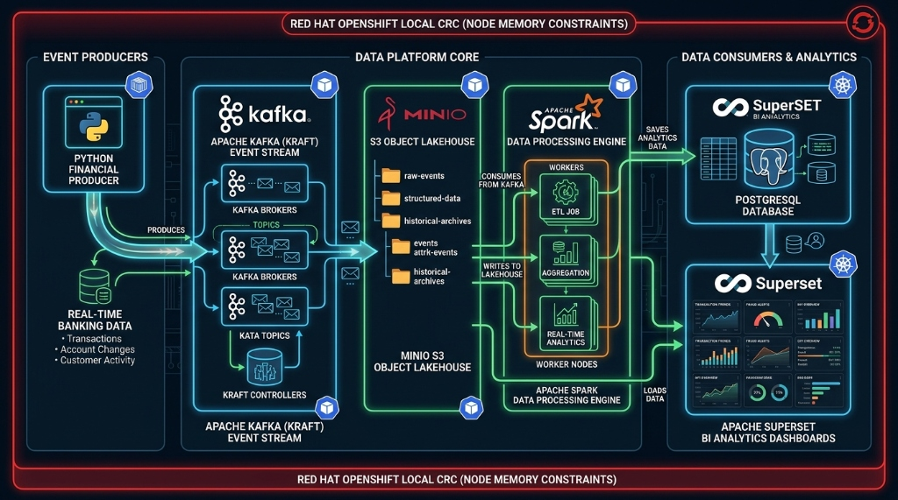
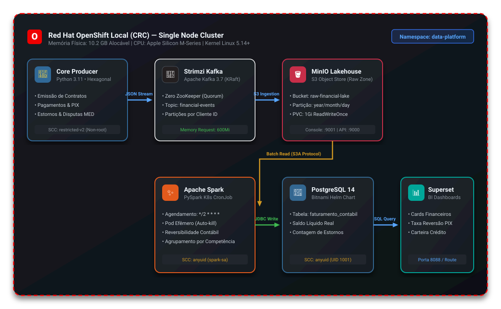
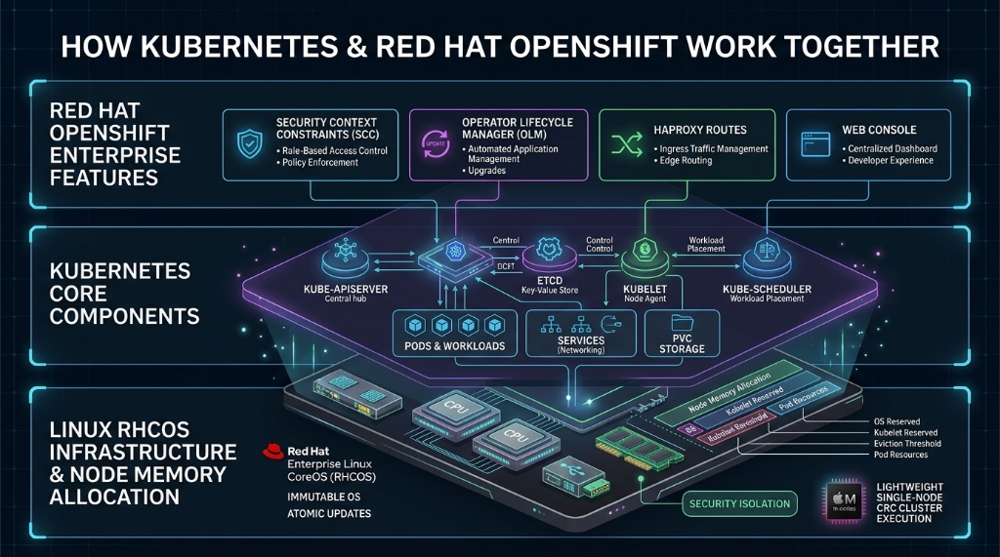
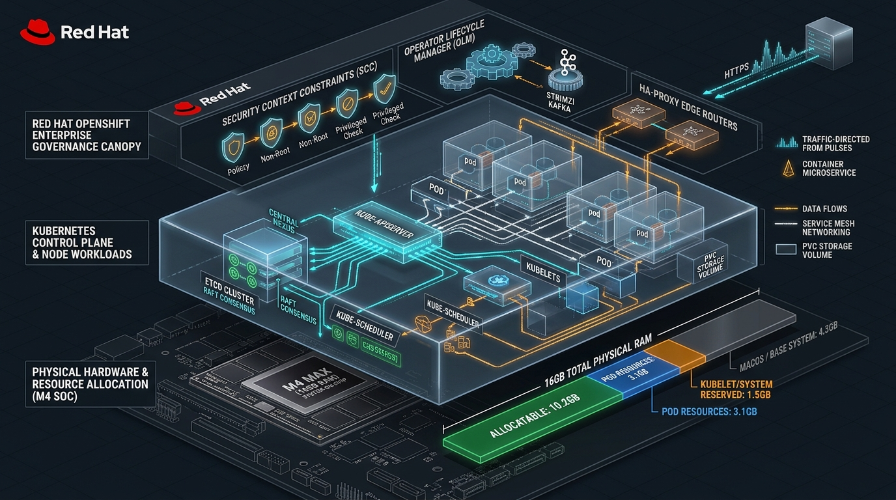
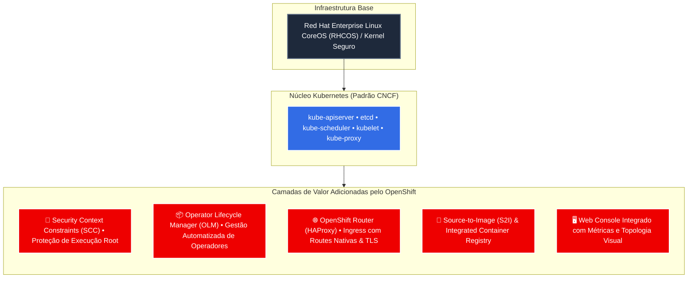
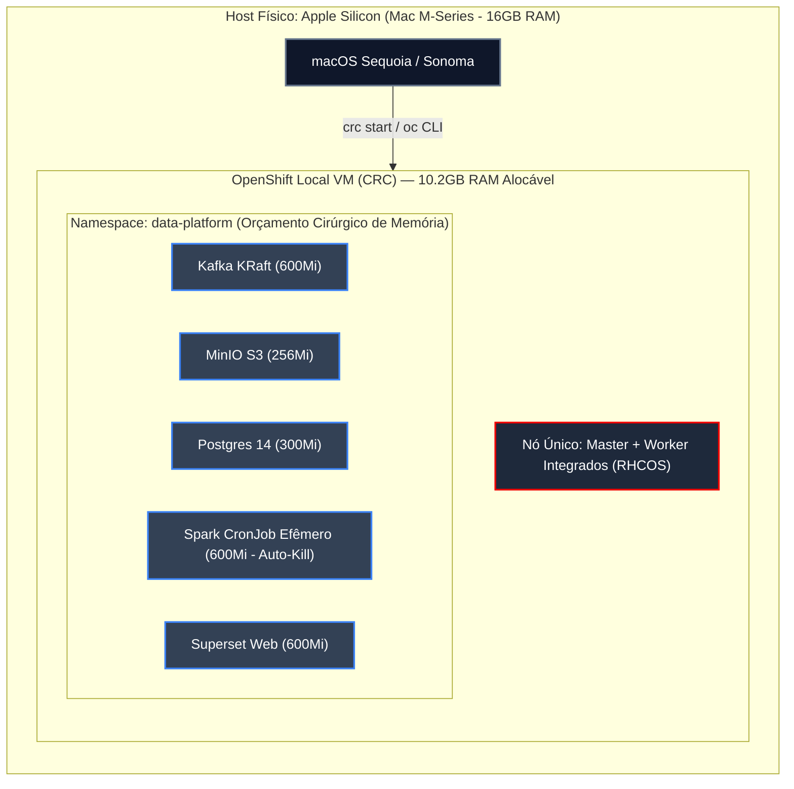
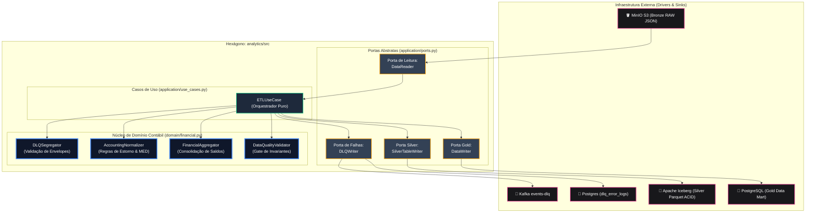

# OpenShift Lean Data Platform

Uma plataforma de dados bancária e analítica de ponta a ponta, nativa em contêineres e orientada a eventos, projetada para operar no limite de recursos de um ambiente **Red Hat OpenShift Local (CRC)** em Apple Silicon (16GB RAM).

---

## 🏗️ 1. Arquitetura de Dados Oficial

O diagrama abaixo ilustra a jornada completa do dado desde a geração do evento transacional no Core Banking até a camada analítica de apresentação no Superset, operando sob o isolamento de segurança e restrição de recursos do cluster.




> 🎮 **Diagrama Interativo (Web Inspector):** Inspecione componentes, restrições K8s e fluxos clicáveis em [`docs/architecture/architecture_interactive.html`](docs/architecture/architecture_interactive.html).
>
> 📐 **Arquivo Editável:** O diagrama vetorial completo está disponível em [`docs/architecture/architecture.drawio`](docs/architecture/architecture.drawio) e [`docs/architecture/architecture.svg`](docs/architecture/architecture.svg).

### 🔀 Diagrama de Fluxo e Componentes Paralelizado (Mermaid)

Para facilitar a compreensão do paralelismo do sistema, o fluxo abaixo modela as vias simultâneas de eventos, o isolamento dos workers de processamento e a concorrência entre persistência contábil e consulta analítica:

```mermaid
flowchart LR
    classDef producer fill:#306998,stroke:#FFD43B,stroke-width:2px,color:white;
    classDef kafka fill:#231F20,stroke:#white,stroke-width:2px,color:white;
    classDef minio fill:#C72E49,stroke:#white,stroke-width:2px,color:white;
    classDef spark fill:#E25A1C,stroke:#white,stroke-width:2px,color:white;
    classDef postgres fill:#336791,stroke:#white,stroke-width:2px,color:white;
    classDef superset fill:#00A699,stroke:#white,stroke-width:2px,color:white;
    classDef boundary fill:#0F172A,stroke:#3B82F6,stroke-width:2px,stroke-dasharray: 4 4,color:white;

    subgraph CoreBanking ["🐍 Ingestão Transacional Paralela"]
        direction TB
        E1["📄 Contratos & Empréstimos"]:::producer
        E2["⚡ Transações PIX"]:::producer
        E3["💳 Pagamentos de Parcelas"]:::producer
        E4["↩️ Estornos & MED"]:::producer
    end

    subgraph KafkaStream ["🦇 Particionamento Kafka (KRaft)"]
        direction TB
        P0["Partição 0 (Clientes Hash A-G)"]:::kafka
        P1["Partição 1 (Clientes Hash H-P)"]:::kafka
        P2["Partição 2 (Clientes Hash Q-Z)"]:::kafka
    end

    subgraph StorageLake ["🪣 Lakehouse S3 (MinIO)"]
        direction TB
        B1["raw-financial-lake/year=2026/month=10/"]:::minio
    end

    subgraph SparkParallel ["✨ PySpark Executors Paralelos (CronJob)"]
        direction TB
        W1["Worker 1: Normalização de Contratos e PIX"]:::spark
        W2["Worker 2: Reversibilidade Contábil de Estornos"]:::spark
    end

    subgraph ServingDW ["🐘 Data Mart & BI"]
        direction TB
        PGB["⚡ PgBouncer\nConnection Pooler (Porta 6432)"]:::postgres
        PG[("PostgreSQL 14\nfaturamento_contabil")]:::postgres
        BI["📊 Superset Dashboards\nConsultas Analíticas"]:::superset
    end

    %% Conexões do Paralelismo de Ingestão
    E1 --> P0
    E2 --> P1
    E3 --> P2
    E4 --> P0
    E4 --> P1

    %% Conexão Kafka -> MinIO
    P0 -->|"S3 Sink Connector"| B1
    P1 -->|"S3 Sink Connector"| B1
    P2 -->|"S3 Sink Connector"| B1

    %% Leitura Paralela Spark
    B1 ==>|"Leitura Particionada S3A"| W1
    B1 ==>|"Leitura Particionada S3A"| W2

    %% Agregação e Escrita / Leitura
    W1 -->|"Consolidação JDBC (6432)"| PGB
    W2 -->|"Consolidação JDBC (6432)"| PGB
    PGB -->|"Pool de Conexões"| PG
    PG -->|"SQL Queries"| BI
```



---

## 🏛️ 2. Guia Profundo e Didático: Kubernetes vs OpenShift

Para entender o funcionamento da plataforma neste cluster local, é essencial compreender o papel do Kubernetes e como o Red Hat OpenShift expande suas capacidades para ambientes corporativos.

### 2.1 O que é o Kubernetes (K8s)?
O **Kubernetes** é o maestro de orquestração de contêineres. Ele resolve o desafio de gerenciar aplicações distribuídas de forma declarativa:
- **Pod:** A menor unidade de execução. Pode conter um ou mais contêineres compartilhando o mesmo namespace de rede (IP e localhost) e volumes de armazenamento.
- **Deployment / ReplicaSet:** Garante que um número especificado de réplicas de um Pod esteja sempre saudável e em execução. Se um contêiner cair, o nó subir outro automaticamente (*Self-healing*).
- **Service:** Um ponto estável de rede (DNS interno e IP virtual) que balanceia requisições entre os Pods daquele serviço.
- **PersistentVolume (PV) e PVC:** Abstração de armazenamento persistente. O Pod requisita armazenamento via `PersistentVolumeClaim` (PVC), desacoplando a infraestrutura física de storage do ciclo de vida efêmero do contêiner.

### 2.2 O que é o Red Hat OpenShift?
O **Red Hat OpenShift** é uma distribuição empresarial completa do Kubernetes. Ele não substitui o Kubernetes: **ele é o Kubernetes em seu núcleo**, complementado por camadas enterprise pré-configuradas e validadas:

#### Perspectiva 1: Arquitetura em Camadas Estruturais (Layers & Control Plane)


#### Perspectiva 2: Visão Isométrica 3D com Detalhamento de Hardware e Orçamento de Memória




### 2.3 Comparativo Prático: Onde o OpenShift se Diferencia no Projeto?

| Funcionalidade | Kubernetes Vanilla | Red Hat OpenShift (Nosso Projeto) |
| :--- | :--- | :--- |
| **Segurança Padrão** | Contêiner roda como `root` se o Dockerfile declarar `USER root`. | Bloqueio automático por **SCC `restricted-v2`**. É obrigatório vincular a SCC `anyuid` para imagens como Postgres (Bitnami UID 1001) e Spark. |
| **Operadores** | Instalação manual de CRDs e controladores via manifests ou Helm. | **Operator Lifecycle Manager (OLM)** nativo. O Kafka é mantido e auto-recuperado pelo operador oficial **Strimzi**. |
| **Exposição Externa** | Exige configuração de Ingress Controllers adicionais (ex: Nginx Ingress). | Recurso nativo **`Route`** apontando para o router HAProxy, gerando URLs corporativas como `*.apps-crc.testing`. |
| **Gerenciamento de Nó** | Distribuição Linux genérica (Ubuntu, Debian, Alpine). | **Red Hat CoreOS (RHCOS)** com sistema de arquivos imutável e atualizações atomizadas. |

---

## 💻 3. Como o OpenShift Roda Localmente (CRC)

O **OpenShift Local (anteriormente CodeReady Containers - CRC)** roda um cluster OpenShift completo de nó único dentro de uma Máquina Virtual (Hypervisor macOS / Apple Hypervisor Framework).



### O Desafio de Recursos e o "Orçamento Cirúrgico de Memória"
Em uma máquina de 16GB, o nó do CRC dispõe de aproximadamente **10.2 GB de memória alocável**. Os operadores de infraestrutura padrão do OpenShift consomem sozinhos quase a totalidade dessa cota:
1. **Desativação de Operadores Secundários:** O operador de monitoramento do cluster (`openshift-monitoring`), o catálogo de mercado (`marketplace`) e o atualizador de cluster (`cluster-version-operator`) foram escalados para 0 réplicas.
2. **Kafka sem ZooKeeper (KRaft):** Eliminamos o ZooKeeper do Apache Kafka, reduzindo o consumo de memória de mensageria em mais de 60%.
3. **Computação Efêmera (Serverless Batch):** Em vez de manter um cluster Spark Standalone ligado 24/7 consumindo RAM, usamos **Kubernetes CronJobs**. O contêiner do PySpark sobe a cada 2 horas, processa a partição de dados do MinIO, grava no Postgres e finaliza (`Completed`), liberando seus 600MiB de RAM imediatamente de volta para a VM.
4. **Otimização de Footprint do Apache Superset:** O deployment do Superset via Helm foi otimizado reduzindo o número de Gunicorn workers de ~10 (padrão) para apenas 2 trabalhadores com 4 threads, desativando pods de suporte (`supersetWorker` e `supersetCeleryBeat`) e fixando o limite em 512Mi para garantir consumo estritamente inferior a 600MiB de RAM no nó único.

---

## 🧩 4. Arquitetura de Software dos Componentes (Hexagonal & SOLID)

Toda a base de código foi estruturada sob o paradigma da **Arquitetura Hexagonal (Ports and Adapters)** de Alistair Cockburn e rigorosamente alinhada aos **Princípios SOLID**, garantindo que o núcleo das regras de negócio financeiras permaneça 100% puro, testável e agnóstico de frameworks, drivers ou serviços de nuvem.

### 4.1 Visão Hexagonal (Ports & Adapters)



---

### 4.2 Mapeamento Prático dos Princípios SOLID

| Princípio | Aplicação no Código do Projeto | Benefício Técnico |
| :--- | :--- | :--- |
| **S — Single Responsibility Principle (SRP)** | Cada classe no domínio tem uma única responsabilidade de negócio:<br>• [`DLQSegregator`](file:///Users/mauriciohelfstein/dev/openshift-lean-data-platform/analytics/src/domain/financial.py): segrega mensagens inválidas/corrompidas do stream.<br>• [`AccountingNormalizer`](file:///Users/mauriciohelfstein/dev/openshift-lean-data-platform/analytics/src/domain/financial.py): aplica valor financeiro de contratos, transações e inversão de estornos.<br>• [`FinancialAggregator`](file:///Users/mauriciohelfstein/dev/openshift-lean-data-platform/analytics/src/domain/financial.py): computa totais de liquidação, crédito e saldo diário.<br>• [`DataQualityValidator`](file:///Users/mauriciohelfstein/dev/openshift-lean-data-platform/analytics/src/domain/financial.py): valida integridade matemática e datas nulas. | Nenhuma classe acumula lógicas concorrentes; alterações em regras contábeis nunca afetam segregação de mensagens. |
| **O — Open/Closed Principle (OCP)** | Novas camadas de persistência (como a introdução da camada Silver em Apache Iceberg) foram adicionadas criando um novo adaptador ([`IcebergSilverWriter`](file:///Users/mauriciohelfstein/dev/openshift-lean-data-platform/analytics/src/infrastructure/adapters.py)) que implementa a porta [`SilverTableWriter`](file:///Users/mauriciohelfstein/dev/openshift-lean-data-platform/analytics/src/application/ports.py). | O código do motor de domínio e do caso de uso [`ETLUseCase`](file:///Users/mauriciohelfstein/dev/openshift-lean-data-platform/analytics/src/application/use_cases.py) é fechado para modificação de negócio e aberto para extensão tecnológica. |
| **L — Liskov Substitution Principle (LSP)** | Todo leitor e escritor concreto em [`adapters.py`](file:///Users/mauriciohelfstein/dev/openshift-lean-data-platform/analytics/src/infrastructure/adapters.py) pode ser substituído por mocks ([`MockDataReader`](file:///Users/mauriciohelfstein/dev/openshift-lean-data-platform/analytics/tests/test_analytics.py), `MockDataWriter`, `MockSilverWriter`) sem que o comportamento do pipeline quebre ou precise de branches condicionais (`if isinstance`). | Testabilidade unitária ultra-rápida em milissegundos sem depender de cluster Hadoop ou PostgreSQL vivo. |
| **I — Interface Segregation Principle (ISP)** | Em vez de criar uma interface monolítica (`IDataEngine`), o sistema define interfaces pequenas e especializadas em [`ports.py`](file:///Users/mauriciohelfstein/dev/openshift-lean-data-platform/analytics/src/application/ports.py):<br>• `DataReader`: apenas contrato de leitura.<br>• `SilverTableWriter`: apenas contrato de materialização transacional.<br>• `DataWriter`: apenas contrato de persistência agregada.<br>• `DLQWriter`: apenas desvio de mensagens falhas. | Clientes e adaptadores não são forçados a implementar métodos que não utilizam. |
| **D — Dependency Inversion Principle (DIP)** | O caso de uso [`ETLUseCase`](file:///Users/mauriciohelfstein/dev/openshift-lean-data-platform/analytics/src/application/use_cases.py) não instancia nem depende de JDBC, S3A, Postgres ou Iceberg. Ele depende estritamente das interfaces abstratas de [`ports.py`](file:///Users/mauriciohelfstein/dev/openshift-lean-data-platform/analytics/src/application/ports.py). A injeção de dependência concreta ocorre no ponto de entrada [`main.py`](file:///Users/mauriciohelfstein/dev/openshift-lean-data-platform/analytics/src/main.py). | Módulos de alto nível de governança contábil não dependem de módulos de baixo nível de storage; ambos dependem de abstrações. |

---

### 4.3 Arquitetura Medallion: Bronze ➔ Silver (Iceberg) ➔ Gold

Para viabilizar **Time Travel**, auditoria contábil imutável e transações ACID sem estourar o orçamento de memória (10.2GB RAM), a plataforma emprega a estratégia **Medallion**:

1. **Camada Bronze (RAW Ingestion):**
   - Arquivos JSON brutos imutáveis gravados pelo Kafka S3 Sink Connector em `s3a://raw-financial-lake/eventos-financeiros/`.
   - Permite reprocessamento histórico retroativo integral.
2. **Camada Silver (Transacional ACID - Apache Iceberg):**
   - Tabela `lakehouse.silver_transacoes_financeiras` formatada em **Parquet colunar**.
   - Gerenciada pelo catálogo **JDBC do PostgreSQL** existente (Custo zero de pods adicionais na VM).
   - Suporte nativo a **Time Travel**:
     ```python
     # Reprodução de saldo contábil no estado exato de uma data/hora no passado
     df_passado = spark.read.option("as-of-timestamp", "1729382400000").table("lakehouse.silver_transacoes_financeiras")
     ```
3. **Camada Gold (Data Mart Agregado):**
   - Tabela `faturamento_contabil_diario` no PostgreSQL servida pelo pooler **PgBouncer (porta 6432)** para alimentar diretamente os dashboards e KPIs do **Apache Superset**.

---

### 4.4 Módulos do Sistema

#### 🐍 `producer/` (Core Banking Producer)
Simula os fluxos de um banco digital moderno emitindo eventos financeiros no formato JSON:
- **`domain/`**: Entidades puras (`FinancialEvent`) e geradores de regras de negócio (Contratos, Empréstimos, Pagamentos, PIX, Estornos e Disputas do Mecanismo Especial de Devolução - MED).
- **`application/`**: Casos de uso (`ProduceEventsUseCase`) e portas de saída abstratas (`MessagePublisher`).
- **`infrastructure/`**: Adaptador concreto para mensageria (`KafkaMessagePublisher`) injetado via porta com desvio automático de falhas para DLQ.

#### ✨ `analytics/` (PySpark Accounting Engine)
Motor analítico em batch que implementa a **Reversibilidade Contábil**:
- Normaliza tipos de eventos conflitantes (pagamentos vs estornos).
- Eventos de contestação ou devolução entram com valor invertido (`-col("valor")`) abatendo a receita contábil da data de competência.
- Gravação transacional na camada Silver Iceberg e consolidação final na camada Gold PostgreSQL.

---

## 🚀 5. Esteira de Integração Contínua (CI Granular)

O repositório possui uma esteira **DAG Ultra Granular** no GitHub Actions, organizada em Jornadas:

```
[ Push / PR ]
      ├── 🛡️ Jornada de Qualidade (Paralelo)
      │     ├── 🎨 Format (Black, Isort)
      │     ├── 🔍 Lint (Flake8)
      │     ├── 🛡️ SAST (Bandit -s B311, Safety)
      │     └── 🏷️ Type Check (Mypy)
      │     └── 🚥 GATE: Quality Passed
      │
      ├── 🧪 Jornada de Testes (Paralelo)
      │     ├── 🧪 Testes Unitários + Cobertura (Pytest-cov)
      │     ├── 🔗 Testes de Integração (Postgres / Kafka Local Stack)
      │     └── 🚥 GATE: Testing Passed
      │
      └── 🚀 Jornada de Release (Condicional: Main/Release)
            ├── 🐳 Build Dockerfile (Multi-stage)
            ├── 🔥 Container Smoke Test Nativo
            └── 🚀 Push de Imagem no Registry
```

---

## 🛠️ 6. Guia Passo a Passo de Configuração

### Pré-requisitos
- Mac com Apple Silicon (M1/M2/M3/M4) e 16GB RAM.
- `crc` (OpenShift Local) e `oc` instalados.
- Helm 3.x.

### 1. Inicializar o Cluster e Configurar Contexto
```bash
./k8s/00-init-mac-crc.sh
eval $(crc oc-env)
oc project data-platform
```

### 2. Liberar Permissões de Segurança (SCC AnyUID)
```bash
oc adm policy add-scc-to-user anyuid -z default -n data-platform
oc adm policy add-scc-to-user anyuid -z superset -n data-platform
oc adm policy add-scc-to-user anyuid -z superset-postgresql -n data-platform
oc adm policy add-scc-to-user anyuid -z spark-sa -n data-platform
```

### 3. Subir Armazenamento e Mensageria
```bash
oc apply -f k8s/01-minio-lean.yaml
oc apply -f k8s/02-kafka-kraft-lean.yaml
```

### 4. Provisionar Data Mart, PgBouncer e Superset (Helm)
```bash
./k8s/03-superset-postgresql.sh
oc apply -f k8s/07-pgbouncer.yaml

# Executar DDL do Data Mart, Dead Letter Queue (DLQ) e views analíticas no PostgreSQL:
oc exec -i -n data-platform $(oc get pods -n data-platform -l app.kubernetes.io/name=postgresql -o jsonpath='{.items[0].metadata.name}') -- psql -U admin -d superset < k8s/06-superset-views.sql
```

### 5. Implantar o Producer e Job Analítico
```bash
oc apply -f k8s/04-producer-deployment.yaml
oc apply -f k8s/05-spark-analytics.yaml
```

### 6. Execução Manual do Job Analítico
```bash
oc create job --from=cronjob/spark-analytics-cron spark-manual-run -n data-platform
oc logs -f job/spark-manual-run -n data-platform
```

---

## 📄 Licença
Distribuído sob licença MIT.

---

## 🛠️ 7. Deep-Dive Tecnológico da Plataforma

Para garantir alta disponibilidade em um ambiente de restrição extrema (OpenShift Local com apenas 10.2GB de RAM alocável), a stack tecnológica foi selecionada com foco em minimalismo (lean architecture), computação sob demanda e resiliência a falhas de contêineres:

### ⚡ Apache Kafka (Modo KRaft)
- **Eliminação do ZooKeeper:** A migração para a arquitetura KRaft unificou o Control Plane e o Data Plane do Kafka, reduzindo em mais de 60% o consumo de memória contínua.
- **Replicação Fina:** O operador **Strimzi** gerencia o Kafka nativamente via Custom Resource Definitions (CRDs), garantindo auto-recuperação (self-healing) do cluster.

### 🪣 MinIO S3 (Lakehouse Storage)
- **Abstração Cloud-Native:** Atua como um "Lake" local com API 100% compatível com Amazon S3.
- **Isolamento de Estado:** Todo evento de ingestão (RAW) é imutável. Arquivos Parquet fragmentados gerados pelo Kafka Sink Connector são armazenados particionados por `ano/mes/dia`.

### ✨ Apache Spark (Arquitetura CronJob Efêmera)
- **Zero-Cluster Overhead:** Em vez de manter um cluster Standalone ligado ociosamente, optamos pelo `CronJob` do Kubernetes. 
- **Lifecycle Dinâmico:** Um contêiner de PySpark sobe a cada 2 horas, lê a partição isolada do MinIO via `s3a://`, consolida o faturamento contábil aplicando as regras de estorno, grava o delta no Postgres (JDBC) e imediatamente entra no estado de `Completed`, devolvendo os 600Mi de RAM para a VM.

### 🐘 PostgreSQL, PgBouncer & Superset
- **Connection Pooling Leve (PgBouncer):** Atua como proxy reverso gerenciador de conexões na porta `6432` em modo `transaction`, prevenindo a exaustão de conexões no PostgreSQL (`Too many clients`) durante execuções concorrentes do Spark e consultas do Superset sob o limite de 300Mi de RAM.
- **Camada de Apresentação Otimizada:** O PostgreSQL hospeda exclusivamente o `Data Mart` (esquema Estrela simplificado). Apenas os dados contábeis validados pelo Data Quality Gate do Spark são materializados aqui.
- **Reversibilidade Contábil em SQL/Dashboard:** Dashboards do Superset não processam regra de negócio, consumindo apenas as visões (Views) já liquidadas de crédito/débito.
- **Minimização de Footprint do Superset:** Configurado com apenas 2 Gunicorn workers e 4 threads (`GUNICORN_WORKERS=2`, `SERVER_WORKER_AMOUNT=2`), com pods de Celery Beat e background workers desativados, mantendo o consumo de memória do Superset Web estritamente abaixo de 600MiB de RAM.

### 🛡️ Resiliência & Dead Letter Queue (DLQ)
- **Segregação Imediata:** Eventos com campos ausentes ou JSON corrompido são capturados antecipadamente no Producer e pelo parser permissivo do PySpark (`_corrupt_record`).
- **Auditoria Dual:** Registros inválidos são direcionados para o tópico Kafka `events-dlq` e gravados na tabela `dlq_error_logs` no PostgreSQL com o payload original e causa do erro, assegurando que eventos danificados não contaminem o balanço contábil nem paralisem o pipeline.
